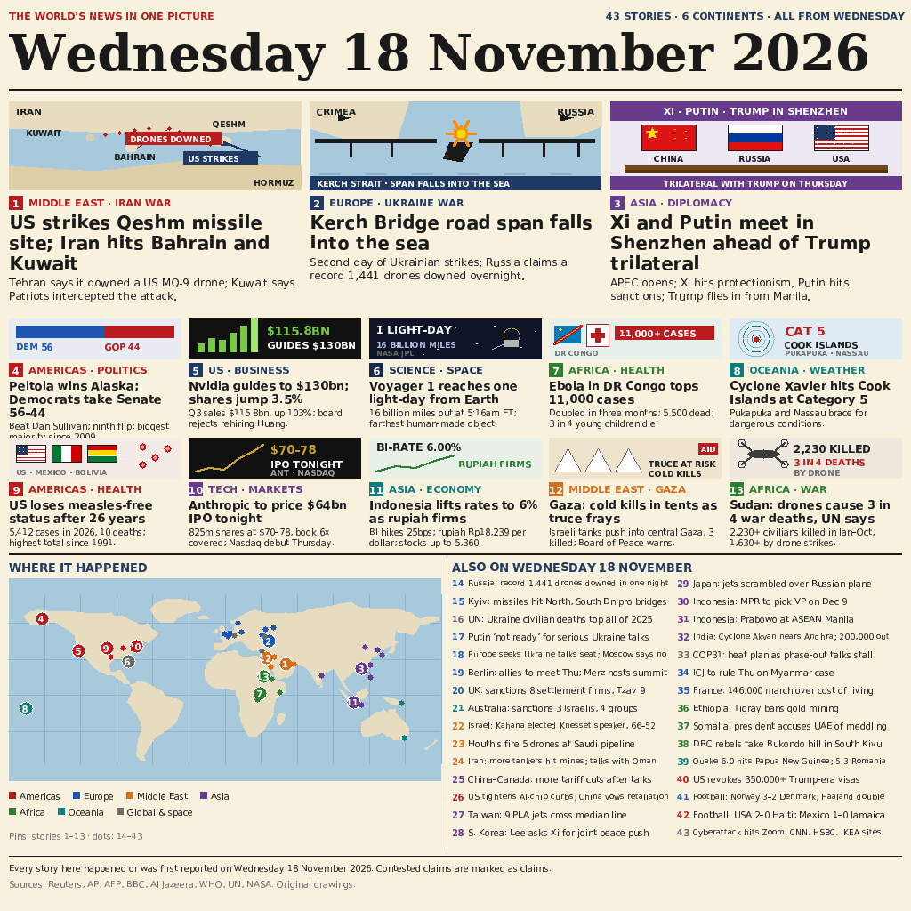

# Wednesday 18 November 2026 — the world's news in one picture

[](https://make.fun/bounty/news-image-20261118)
[](https://make.fun/bounty/news-image-20261118/leaderboard)
[](https://make.fun/bounty/news-image-20261118)

A one-page newspaper that sums up the world news of Wednesday 18 November 2026:
43 stories from 6 continents, drawn by a deterministic Python program.
No network, no AI images — every illustration is vector art drawn in code,
and every word is rendered from bitmap fonts packed in `font.bin`.



## What is in the picture

- **Masthead:** the date in giant serif type, with the story count.
- **3 hero stories:** the US strikes an Iranian missile site on Qeshm Island
  and Iran fires drones at Bahrain and Kuwait; a Kerch Bridge road span falls
  into the sea on the second day of Ukrainian strikes; Xi and Putin meet in
  Shenzhen ahead of a trilateral with Trump.
- **10 more stories** in small cards: Peltola wins Alaska and the Democrats
  take the Senate 56–44, Nvidia guides to $130bn, Voyager 1 reaches one
  light-day from Earth, Ebola in DR Congo tops 11,000 cases, Cyclone Xavier
  hits the Cook Islands at Category 5, the US loses measles-free status after
  26 years, Anthropic prices a $64bn IPO, Indonesia lifts rates to 6%, the
  Gaza truce frays, and drones cause 3 in 4 war deaths in Sudan.
- **Where it happened:** a world map with numbered pins for stories 1–13 and
  dots for stories 14–43.
- **Also on:** 30 more one-line stories, numbered 14–43.
- **Footer:** sources and a verification line — every story happened or was
  first reported on Wednesday 18 November 2026.

## How it is made

`main.py` (Python 3.13, standard library only) draws the whole page on a
1024×1024 canvas and writes `/output/entry.png`. It reads glyph bitmaps from
`font.bin` (DejaVu Serif/Sans) and uses no network, so two runs write the
exact same bytes.

Run it:

```sh
python3 main.py
```

Set `MAKEFUN_OUTPUT_DIR` to change where the image is written (default
`/output`).

## Sources

Reuters, AP, AFP, BBC, Al Jazeera, WHO, UN, NASA. Original drawings.

## Licence

MIT — see [LICENSE](LICENSE).
